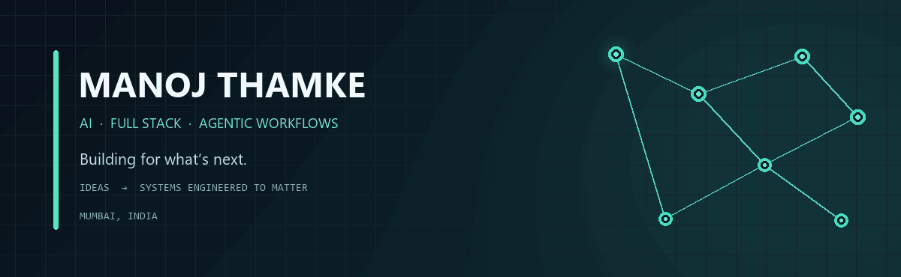

  

  
  
  

MUMBAI, INDIA&nbsp; · &nbsp;AI / ML&nbsp; · &nbsp;FULL STACK&nbsp; · &nbsp;AGENTIC SYSTEMS

---

## 01 / About

I’m Manoj, an Information Technology graduate from Mumbai University. I turn complex ideas into useful, dependable software—working across product interfaces, backend systems, and applied machine learning. I enjoy the full path from shaping an idea to designing its APIs, handling edge cases, and refining the details people use every day.

**Currently:** AI, Full-Stack & Trading Systems Developer at **Web Helix Pvt Ltd** *(Oct 2026–Present)*, building across AI/ML, agentic workflows, algorithmic-trading tools, and full-stack applications.

## 02 / Featured · Agentic systems

<table>
  <tr>
    <td width="50%" valign="top">
      <h3>✳ Agentic OS</h3>
      
<strong>PERSONAL AGENT WORKSPACE · IN PROGRESS</strong>

      
A personal agentic workspace built around Hermes Agent on a VPS with Telegram. It brings together a persistent agent profile and reusable skills for AI learning, coding, trading study, and daily workflows—with a longer-term goal of automating pre-market briefs and trading journals.

      Hermes Agent · Telegram · Agent skills · Workflow automation  
      <a href="https://github.com/ManojThamke/agentic-os">Explore the Agentic OS repository ↗</a>
    </td>
    <td width="50%" valign="top">
      <h3>◈ AEGIS AI</h3>
      
<strong>MISSION INTELLIGENCE WORKBENCH · PHASE 1 DEMO</strong>

      
A structured mission workflow that records a mission, queues three traceable local steps, and labels its output as illustrative. This phase does not browse the web, call a model, or execute external actions.

      Next.js · TypeScript · PostgreSQL / pgvector · Redis · BullMQ · Drizzle  
      <a href="https://github.com/ManojThamke/AGEIS">Explore AEGIS AI ↗</a> ·
      <a href="https://github.com/ManojThamke/AGEIS/blob/main/ARCHITECTURE.md">Architecture ↗</a>
    </td>
  </tr>
</table>

## 03 / Selected work

<table>
  <tr>
    <td width="50%" valign="top">
      <h3>01 · Network Intrusion Detection</h3>
      
<strong>RESEARCH · CYBERSECURITY</strong>

      
A confidence-aware hybrid ML engine with a live monitoring dashboard, built to make network threats easier to see and act on.

      
<strong>99.81% model accuracy</strong> Published at IEEE ACROSET 2026.

      Python · XGBoost · MERN · Machine Learning  
      <a href="https://github.com/ManojThamke/ML_NIDS">View project repository ↗</a>
    </td>
    <td width="50%" valign="top">
      <h3>02 · DevLearn</h3>
      
<strong>PRODUCT · AI LEARNING</strong>

      
An AI-powered coding platform with structured learning paths, hands-on projects, and a containerized code-evaluation pipeline.

      
<strong>88 lessons built</strong>

      React · Gemini API · Redis · Docker  
      <a href="https://github.com/ManojThamke/DevLearn">View project repository ↗</a>
    </td>
  </tr>
  <tr>
    <td width="50%" valign="top">
      <h3>03 · Legal Document Research Assistant</h3>
      
<strong>AI · DOCUMENT RETRIEVAL</strong>

      
A Python RAG prototype that indexes Supreme Court judgments, retrieves relevant passages with Qdrant, and returns document-grounded answers with page references.

      Python · Qdrant · Embeddings · OpenRouter  
      <a href="https://github.com/ManojThamke/legal-rag">View project repository ↗</a>
    </td>
    <td width="50%" valign="top">
      <h3>04 · MedGenix</h3>
      
<strong>ML · FULL-STACK PROTOTYPE</strong>

      
A research and education prototype connecting voice-feature classification to a FastAPI service, React interface, MongoDB persistence, and generated reports.

      
<strong>22 voice features</strong>

      Python · scikit-learn · FastAPI · React · MongoDB  
      <a href="https://github.com/ManojThamke/MedGenix">View project repository ↗</a>
    </td>
  </tr>
  <tr>
    <td width="50%" valign="top">
      <h3>05 · Distributed Job Scheduler</h3>
      
<strong>SYSTEMS · IN PROGRESS</strong>

      
A durable backend for queuing, retrying, and distributing background jobs across workers—built for the work that happens behind the UI.

      Node.js · Redis · PostgreSQL · Docker · BullMQ  
      <a href="https://github.com/ManojThamke/distributed-job-scheduler">View project repository ↗</a>
    </td>
    <td width="50%" valign="top">
      <h3>More work, in context</h3>
      
See the product stories, interface, and project details on my portfolio.

      <a href="https://www.manojthamke.me/#work"><strong>Explore selected work ↗</strong></a>
    </td>
  </tr>
</table>

## 04 / Experience

### AI, Full-Stack & Trading Systems Developer · Web Helix Pvt Ltd
*Oct 2026–Present*

Building across AI/ML, agentic workflows, algorithmic-trading tools, and full-stack applications.

### Full Stack Developer Intern · IISPPR
*Jan–Apr 2026 · 568+ hours*

Delivered three production-focused projects, built 15+ REST APIs, and implemented JWT authentication and an admin/coordinator CRM workflow for IISPPR Academy.

### Web Development Intern · Coreline Solutions
*Jul 2025–Jan 2026*

Built a YouTube-inspired training product with React and JavaScript, and developed Node.js REST APIs with user authentication.

### WordPress Development Intern · WebHelix
*Jun–Aug 2022*

Created a WordPress site with custom page layouts, motion, and an e-commerce cart with payment integration.

## 05 / Toolkit

  

Machine Learning · REST APIs · JWT / RBAC · Agentic Workflows · Trading Systems

## 06 / Education & certifications

- **B.E. Information Technology** · Alamuri Ratnamala Institute of Engineering & Technology · Mumbai University · 2023–2026 · **CGPA 7.98**
- **Diploma, Information Technology** · Vidyalankar Polytechnic, Mumbai · 2020–2023
- SkillEcted: HTML & CSS, JavaScript, Node.js & MongoDB
- Internshala / NSDC Skill India: Programming with Python · **Grade A**
- Internshala: Programming in Python with AI · **Top performer**

[View certificates ↗](https://drive.google.com/drive/folders/1CbijxLuI4Jg3UC_Gm6SWZQq502aHDCH1?usp=sharing)

---

  <strong>Have a good problem? Let’s solve it.</strong> 
  <a href="https://www.manojthamke.me/">Visit my portfolio</a> &nbsp;·&nbsp;
  <a href="https://www.linkedin.com/in/manoj-thamke/">Connect on LinkedIn</a> &nbsp;·&nbsp;
  <a href="https://github.com/ManojThamke?tab=repositories">Browse my repositories</a>

