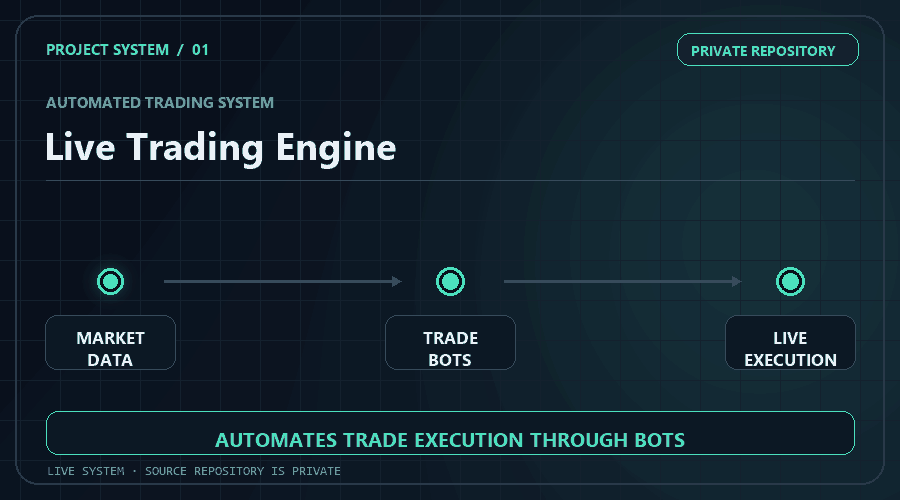
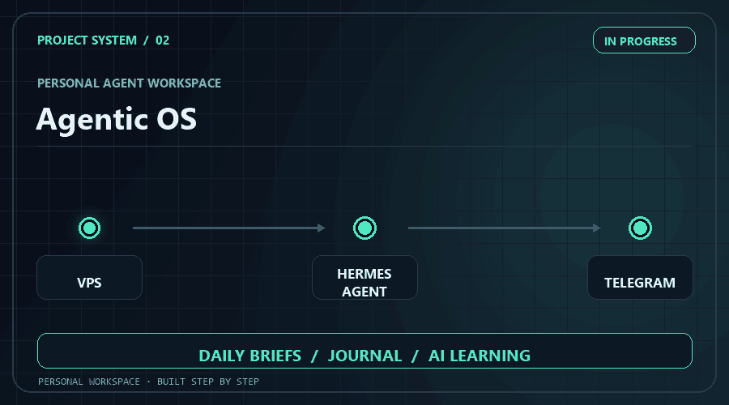
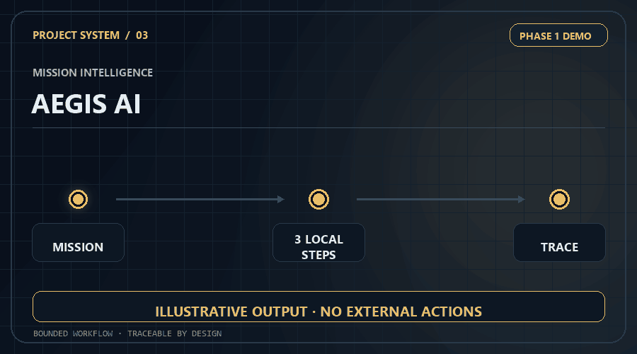
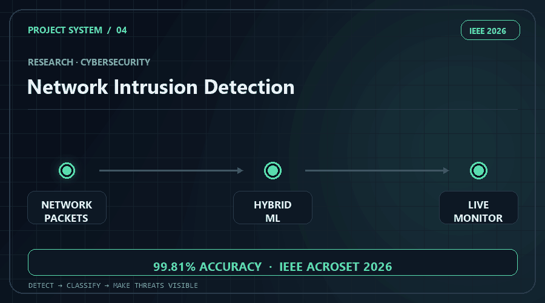
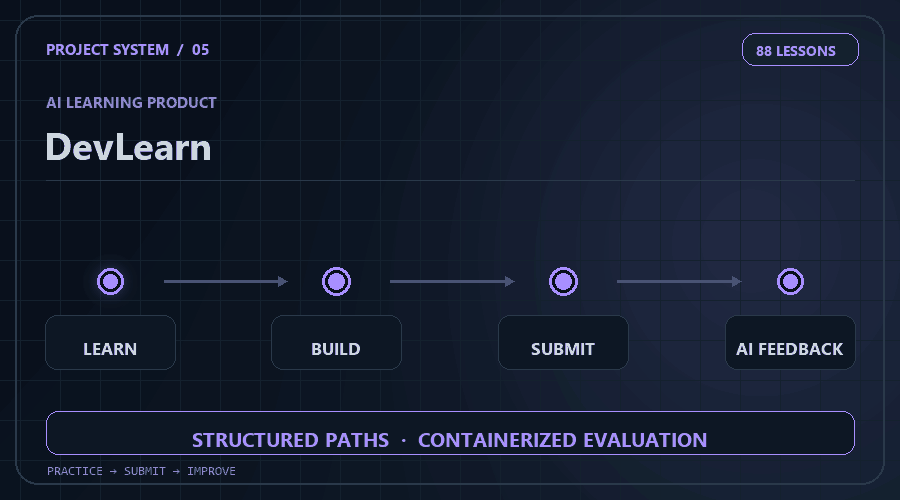
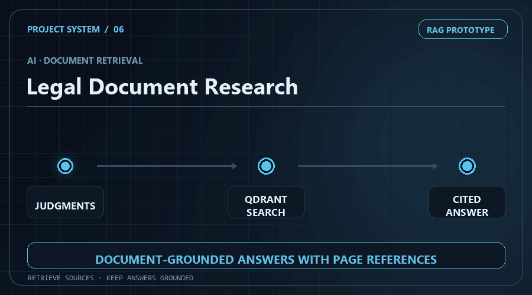
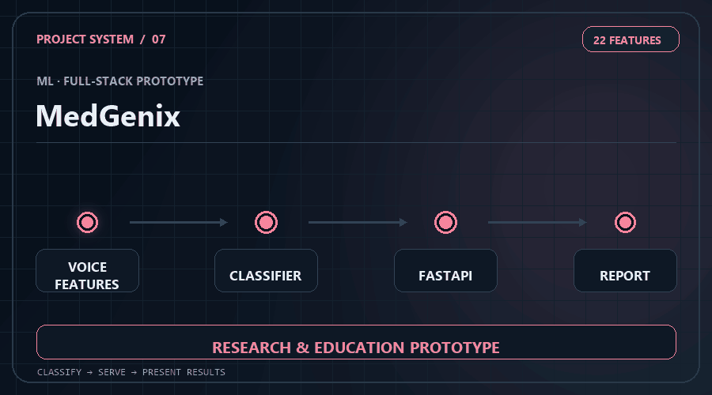
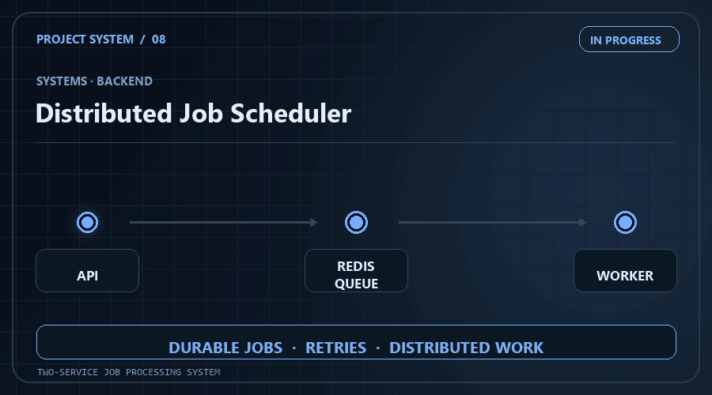

  

  
  
  

MUMBAI, INDIA&nbsp; · &nbsp;AI / ML&nbsp; · &nbsp;FULL STACK&nbsp; · &nbsp;AGENTIC SYSTEMS

---

## 01 / About

I’m Manoj, an Information Technology graduate from Mumbai University. I turn complex ideas into useful, dependable software—working across product interfaces, backend systems, and applied machine learning.

**Currently:** AI, Full-Stack & Trading Systems Developer at **Web Helix Pvt Ltd** *(Oct 2026–Present)*, building across AI/ML, agentic workflows, algorithmic-trading tools, and full-stack applications.

## 02 / Main attraction · Live Trading Engine

  

<strong>LIVE TRADING SYSTEM · PRIVATE REPOSITORY</strong> A live trading system that automates trades using bots.

## 03 / Featured · Agentic systems

<table>
  <tr>
    <td width="50%" valign="top">
      
      
A personal agentic workspace built around Hermes Agent on a VPS with Telegram. It brings together a persistent agent profile and reusable skills for AI learning, coding, trading study, and daily workflows, with pre-market briefs and trading journals as goals.

      
<a href="https://github.com/ManojThamke/agentic-os">View Agentic OS ↗</a>

    </td>
    <td width="50%" valign="top">
      
      
A mission intelligence workbench. Phase 1 records a mission, queues three traceable local steps, and labels output as illustrative. It does not browse the web, call a model, or execute external actions.

      
<a href="https://github.com/ManojThamke/AGEIS">View AEGIS AI ↗</a> · <a href="https://github.com/ManojThamke/AGEIS/blob/main/ARCHITECTURE.md">Architecture ↗</a>

    </td>
  </tr>
</table>

## 04 / Selected work

<table>
  <tr>
    <td width="50%" valign="top">
      
      
A confidence-aware hybrid ML engine with a live monitoring dashboard. Reported **99.81% accuracy**; published at IEEE ACROSET 2026.

      
<a href="https://github.com/ManojThamke/ML_NIDS">View NIDS project ↗</a>

    </td>
    <td width="50%" valign="top">
      
      
An AI-powered coding platform with structured learning paths, hands-on projects, and containerized code evaluation. **88 lessons built.**

      
<a href="https://github.com/ManojThamke/DevLearn">View DevLearn ↗</a>

    </td>
  </tr>
  <tr>
    <td width="50%" valign="top">
      
      
A Python RAG prototype that indexes Supreme Court judgments, retrieves passages with Qdrant, and returns document-grounded answers with page references.

      
<a href="https://github.com/ManojThamke/legal-rag">View Legal RAG ↗</a>

    </td>
    <td width="50%" valign="top">
      
      
A research and education prototype connecting voice-feature classification to FastAPI, a React interface, MongoDB persistence, and generated reports.

      
<a href="https://github.com/ManojThamke/MedGenix">View MedGenix ↗</a>

    </td>
  </tr>
  <tr>
    <td width="50%" valign="top">
      
      
A backend system for queuing, retrying, and distributing background jobs across workers.

      
<a href="https://github.com/ManojThamke/distributed-job-scheduler">View job scheduler ↗</a>

    </td>
    <td width="50%" valign="top">
      
<strong>More work, in context</strong> Visit my portfolio for the full project stories and details.

      
<a href="https://www.manojthamke.me/#work">Explore all selected work ↗</a>

    </td>
  </tr>
</table>

## 05 / Experience

### AI, Full-Stack & Trading Systems Developer · Web Helix Pvt Ltd
*Oct 2026–Present*

Building across AI/ML, agentic workflows, algorithmic-trading tools, and full-stack applications.

### Full Stack Developer Intern · IISPPR
*Jan–Apr 2026 · 568+ hours*

Delivered three production-focused projects, built 15+ REST APIs, and implemented JWT authentication and an admin/coordinator CRM workflow for IISPPR Academy.

### Web Development Intern · Coreline Solutions
*Jul 2025–Jan 2026*

Built a YouTube-inspired training product with React and JavaScript, and developed Node.js REST APIs with user authentication.

### WordPress Development Intern · WebHelix
*Jun–Aug 2022*

Created a WordPress site with custom page layouts, motion, and an e-commerce cart with payment integration.

## 06 / Toolkit

  

Machine Learning · REST APIs · JWT / RBAC · Agentic Workflows · Trading Systems

## 07 / Education & certifications

- **B.E. Information Technology** · Alamuri Ratnamala Institute of Engineering & Technology · Mumbai University · 2023–2026 · **CGPA 7.98**
- **Diploma, Information Technology** · Vidyalankar Polytechnic, Mumbai · 2020–2023
- SkillEcted: HTML & CSS, JavaScript, Node.js & MongoDB
- Internshala / NSDC Skill India: Programming with Python · **Grade A**
- Internshala: Programming in Python with AI · **Top performer**

[View certificates ↗](https://drive.google.com/drive/folders/1CbijxLuI4Jg3UC_Gm6SWZQq502aHDCH1?usp=sharing)

---

  <strong>Have a good problem? Let’s solve it.</strong> 
  <a href="https://www.manojthamke.me/">Visit my portfolio</a> &nbsp;·&nbsp;
  <a href="https://www.linkedin.com/in/manoj-thamke/">Connect on LinkedIn</a> &nbsp;·&nbsp;
  <a href="https://github.com/ManojThamke?tab=repositories">Browse my repositories</a>

