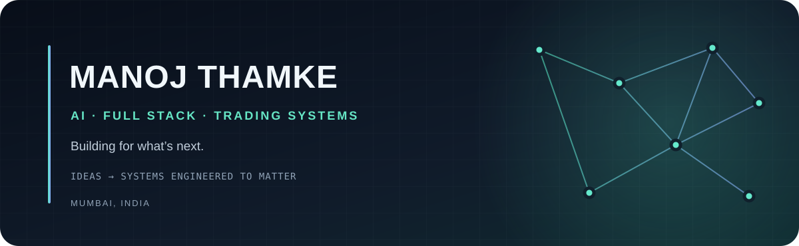

  

  
  
  

  <em>Full Stack Developer · MERN · Applied Machine Learning</em> 
  I build thoughtful web products, dependable backend systems, and practical AI experiences.

---

## ✦ About

Software developer with hands-on full stack internship experience across APIs, authentication, admin workflows, and AI-powered products. I also co-authored an IEEE ACROSET 2026 paper on machine learning for network intrusion detection, reporting **99.81% accuracy**.

| | |
|:--|:--|
| 🎓 **Education** | B.E. Information Technology · Mumbai University · CGPA 7.98/10 |
| 💼 **Experience** | Full Stack Developer Intern · IISPPR · 568 hours, 3 projects |
| 🔭 **Learning** | Docker, CI/CD, AWS, and production-minded backend engineering |
| 💬 **Topics** | MERN, REST API design, and ML-based intrusion detection |

## ⚙️ Toolkit

  

Also worked with scikit-learn · XGBoost · LightGBM · BullMQ · Tailwind CSS · Framer Motion · JWT · Zod · Gemini API · Vercel

## 🚀 Selected work

<table>
  <tr>
    <td width="50%" valign="top">
      <h3>🛡️ Network Intrusion Detection</h3>
      
Machine learning research and a real-time MERN dashboard for monitoring network traffic and detecting multiple attack classes.

      
<strong>99.81% accuracy</strong> · <strong>82.72% F1</strong> Benchmarked 9 models on CICIDS2018 with 2M+ packets; the confidence-aware hybrid engine improved ensemble precision by 4.2%.

      Python · scikit-learn · XGBoost · LightGBM · React · Node.js · MongoDB  
      <a href="https://github.com/ManojThamke">IEEE ACROSET 2026 · Explore my repositories ↗</a>
    </td>
    <td width="50%" valign="top">
      <h3>🎓 DevLearn</h3>
      
An AI-assisted code learning platform with structured lessons, practical projects, code evaluation, and containerized execution.

      
<strong>5 courses</strong> · <strong>88 lessons</strong> · <strong>28 projects</strong> GitHub/ZIP submissions flow through AI evaluation and Redis-backed background analysis.

      React · Node.js · MongoDB · Redis · Docker · Gemini API
    </td>
  </tr>
  <tr>
    <td width="50%" valign="top">
      <h3>⏱️ Distributed Job Scheduler</h3>
      
Two-service job scheduling system: an API accepts validated jobs and BullMQ workers process them. PostgreSQL stores durable job data; Redis handles queueing.

      Node.js · BullMQ · Redis · PostgreSQL · MongoDB · Docker Compose  
      <a href="https://github.com/ManojThamke/distributed-job-scheduler">View repository ↗</a>
    </td>
    <td width="50%" valign="top">
      <h3>🐞 Bug / Issue Tracker</h3>
      
Jira-style project and ticket management with Kanban views, team assignment, progress tracking, and searchable issues.

      React · Node.js · Express · MongoDB · JWT · Tailwind CSS  
      <a href="https://github.com/ManojThamke/bug-tracker">View repository ↗</a>
    </td>
  </tr>
</table>

## 💼 Experience

**Full Stack Developer Intern** · International Institute of SDGs & Public Policy Research (IISPPR)  
*Jan–Apr 2026 · 568 hours · 3 projects delivered*

- Built **15+ REST APIs** for the IISPPR Academy website, including admin and coordinator CRM workflows with JWT authentication.
- Delivered a responsive portfolio with interactive animations and a Nodemailer-powered contact form.
- Built a research policy management backend with JWT, role-based access control, and MongoDB CRUD APIs.

## 📈 GitHub

  
  

## 🎓 Education & credentials

- **B.E. Information Technology** · Alamuri Ratnamala Institute of Engineering & Technology, Mumbai University · 2023–2026 · CGPA 7.98/10
- **Diploma in Information Technology** · Vidyalankar Polytechnic, Mumbai · Final year 75.38%
- Skillected Academy: HTML & CSS, JavaScript, Node.js & MongoDB
- Internshala Trainings (NSDC Skill India): Programming with Python · Grade A

---

  <strong>Open to Full Stack (MERN) and Software Developer opportunities</strong> 
  Thanks for stopping by — feel free to explore my repositories.

